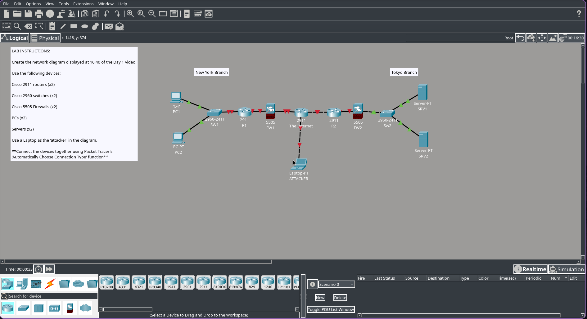

# Lab 1: Network devices & topology

## Overview
This Lab correponds to ***day 1** of Jeremy's IT Lab CCNA 200-301 course. The primary objetive is to understand the functions of fundamental network nodes and build a basic multi-branch enterprise network topology connected via the Internet. Including an external security threat (attacker simulator)

## Network Diagram

## Components & Devices used
Following the lab requirements, the topology was built using the following equipment in Cisco Packet Tracer:
* **Routers:** 2x Cisco 2911 Routers (`R1` for New York Branch, `R2` for Tokyo Branch).
* **Switches:** 2x Cisco 2960 Switches (`SW1`, `SW2`) for local area connectivity.
* **Firewalls:** 2x Cisco 5505 Firewalls (`5505 FW1`, `5505 FW2`) acting as security perimeters.
* **End Hosts:** 2x PCs (`PC1`, `PC2`) and 2x Servers (`SRV1`, `SRV2`).
* **Security Simulation:** 1x Laptop configured as an `ATTACKER` connected through the Internet cloud.
* **Cable Management:** Automatically configured connection types in Cisco Packet Tracer to link LAN devices and wide-area links.

## Key Concepts & Takeaways

* **Clients:** End-user devices (such as PCs and laptops) that request services, data, or resources from servers.
* **Servers:** Systems or devices that provide functions, content, or services to network clients (e.g., file or application servers).
* **Switches:** Used to aggregate and forward traffic within a Local Area Network (LAN).
* **Routers:** Designed to connect multiple separate networks together and handle traffic routing across the Internet.
* **Firewalls:** Placed at network boundaries to monitor, filter, and control incoming/outgoing traffic based on security policies, protecting internal hosts from external attackers.
