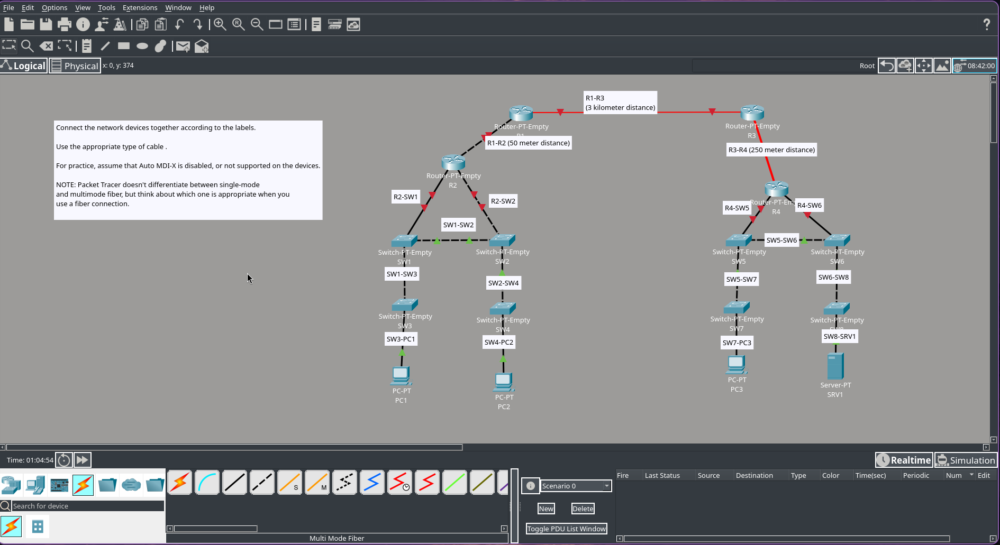

# Lab 2: Interfaces & cables

## Overview

## Overview
This lab correspond to **Day 2** of Jeremy's IT Lab CCNA 200-301 course. The goal is to understand physical network connectivity, identify interface types, select the correct physical cables (copper v fiber-optic, sraight-through vs crossover), and configure multi-site connections across routers and switches.

## Network diagram

## Cable Types & Interface Standards
Based on the lab instructions and physical distance requirements, the following connections were implemented:

1. **Copper Connections (UTP / RJ-45):** Used for standard LAN links between end-hosts, switches, and routers over short distances.

2. **Fiber-Optic Connections:** Used for long-distance links between routers (e.g., R1-R2 spanning 50 meters, R1-R3 spanning 3 kilometers, and R3-R4 spanning 250 meters).

3. **Single-Mode Fiber (SMF):** Used for long-range transmissions (such as the 3 km link between R1 and R3), characterized by a lighter yellow port color.

4. **Multi-Mode Fiber (MMF):** Used for shorter high-speed links, characterized by an orange/darker port color.

## Key Concepts & Takeaways
* **RJ-45 Ports:** The standard physical connector interface found on Ethernet switches and routers for twisted-pair copper cabling.
* **Straight-Through vs. Crossover Cables:** Traditional distinction for connecting different device types (PC-to-Switch) vs. similar device types (Switch-to-Switch / Router-to-Router), though modern hardware largely abstracts this.
* **Auto MDI-X:** A modern feature on Cisco interfaces that automatically detects the required cable pinout, allowing devices to establish links correctly even if an incorrect cable type is used.
* **Fiber Distances:** Understanding the physical limitations and use cases of Single-Mode (long distance) versus Multi-Mode (shorter distance) fiber optics.

