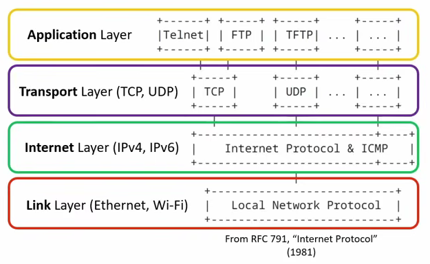
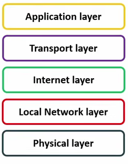
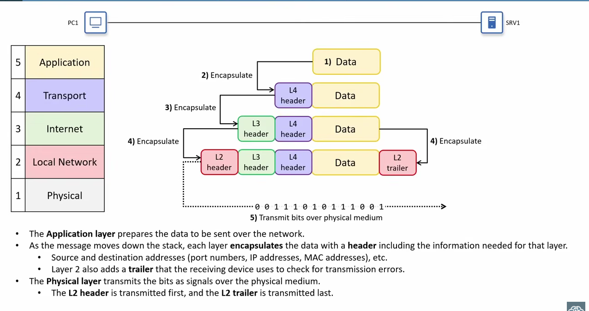
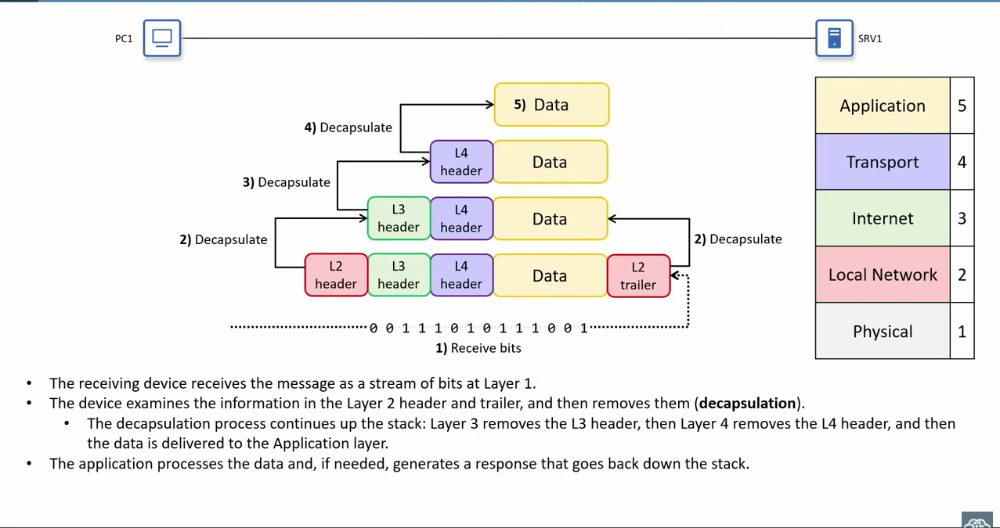

# Lab 03: TCP/IP model

how does actually work TCP/IP

## Overview

* **Course reference:**
* **Simulator used:**

TCP/IP model

- Aplication layer

- Transport layer

- Internet layer\local network layer

- physical

## Importance of a protocol

Set of rules defining how data should be comunicated between device over a network

Standard: an agreed-upon specification that describes how a protocol or technology should work

### where TCP/IP comes from

TCP/IP became a dominant over vendor-propietary solutions at the time because it was published as a set of ppen standards that any vendor could implement, and it could run over many different types of networks

#### Who defines the standards

developed by differents standarts organizations

- IEEE (Institute of Electrical and Electronics Engineers):

  develops many of the tecnologies used on local area networks

  - Ethernet (802.3)

  - WI-FI(802.11)

- IETF (Internet engineering Task Force)

  Open comunity that defines protocols used on the internet

  - TCP,IP,UDP,HTTP,DNS, etc

  - Publishes standards in documents called RFC (Request for comments

#### Layered models

- Network do a lot of differents jobs to move data from one computer to anothes

  - phyisical transmition of signals, local delivery on lan, routing traffic between networks end-to-end conversations, aplicattions, etc

- A model let us group related jobs into layers

  - Each layer has a specific role

  - Each layer uses the services of the layer below and provides services to the layer above

- Protocols live (mostly) at one layer

  - IP,TCP,HTTP, etc

  - Together they form a stack of protocols that work as a team (network sytack)

(a description, not a law)

- The pyisical layer (layer 1) sends and receives bits as electrical, optical or radio signals over the medium

  - Defines things like cables, connectors, signals level, and link speed
  - Example: copper UTP cables, fiber-optic cables, wi-fi radios an antennas, network intrecfaces (NICs)
  - Usually the network engienners don't have to know the low-level details. The phyisical aspects of transmitting data are very complex.

- The local Network layer (Layer 2) provides hop-to-hop delivery of the messages on a local network

  - a hop is one step along the path between two devices

    - from one router or host, to the next router on host in the path

  - switches don't count: a switch just extends the local network, allowing multiple devices to connect

  - Uses MAC adresses to identify interfaces

  - Protocols at this layer include:

    - Ethernet (IEEE 802.3)

    - WI-FI (IEEE 802.11)

- Internet layer (layer 3) provides end-to-end delivery between hosts across multiple networks

  - Uses IP adresses to identify hosts in the network

  - Router operate mainly at this layer, using the message's destination IP adress to foward the message toward it's final destination hosts

  - protocol at this layer

    - IP (IPv4, IPv6)

    - ICMP (Internet COntrok Message Protocol)

- The transport layer (Layer 4) provides end=to-end comunication between application processes

  - Also called process-to process or service-to-service

  - Uses port numbers to identify the processes on each host

  - Runs mainly on the communicating hosts; routers normally operate based on IP (layer 3), not on the transport-layer information

  - Protocols at this layer:

    - UDP (User Datagram Protocol): simple and efficient

    - TCP (Transmission Control Protocol): more robust features beyond basic message adressing 

- The application layer (layer 5) is where network comunications meet applications.

  - Usually called layer 7

  - Defines how application processes format, send and interpret data

  - Protocols at this layer define message formats and rules dor specific task, such as:

    - Browsing web pages (HTTP/HTTPS)

    - Transfering files (FTP, TFTP)

    - Sending/receiving email (SMPT, POP3, IMAP)

### How the layer combine into a stack

Encapsulation

Decapsulation

### Protocol data units

- At each stage in the encapsulation/decapsulation process, there is a name given to the message

  - The combination of data and a L4 header is called secment (TCP) or datagram(UDP)

    - TCP creates segments, UDP creates datagrams
  
  - The combination of a segment/datagram and L3 header is called a packet
  - The combination of a packet and L2 header/trailer is called a frame
    - This is what actually send over the wire
  
  ##### ALternative names to decribe the message at each stage: Protocol data unit (PDU)
    - A segment of atagram is a layer 4 PDU (L4PDU)
    - A packet is a Layer 3 PDU (L3PDU)
    - A frame is a Layer 2 PDU (L2PDU)
  ### The content of each PDU (everything encapsulated by the layer's header/trailer) are called the payload
  - A segment or datagram payload is the application data
  - A packet's payload is a segment or datagram
  - a frame's payload is a packet